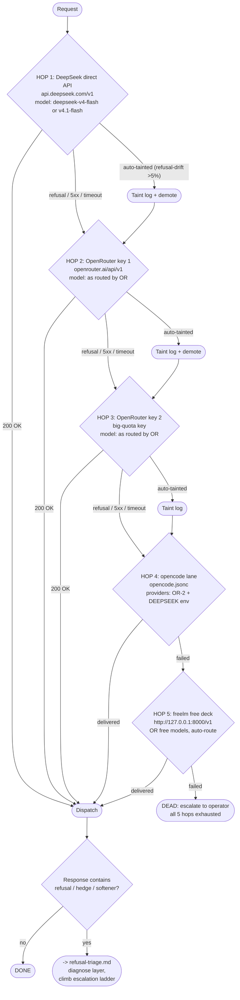

# Fleet Fallback Chain

## Purpose

Deterministic provider fallback chain for the WORM (9185W) fleet. When the
primary provider refuses, errors, times out, or is auto-tainted, the chain
advances to the next hop. Each hop has a defined trigger condition, a quota
budget, and a taint posture. The chain is a linear priority queue, not a
load-balancer -- later hops are only reached when earlier hops fail.

Chain source of truth: `~/worm-handoff/KEYS-ROSTER-20261015.md` [source:
KEYS-ROSTER-20261015.md]. Key values live ONLY in `~/.hermes/.env` and
`/etc/opencode/opencode.jsonc`; the roster carries fingerprints only.

## Chain hop specifications

### Hop 1: DeepSeek direct API (PRIMARY)

- **Key fingerprint:** sk-ef14..10fd (48 chars) [source: KEYS-ROSTER-20261015.md]
- **Endpoint:** https://api.deepseek.com/v1
- **Models:** deepseek-v4-flash, deepseek-v4.1-flash (cheap reasoning + code
  lane per provider-selection.md)
- **Quota:** live, 200 OK verified as of 2026-10-15
- **Trigger to advance:** refusal event (matches refusal-lint regex or
  semantically softened per StrongREJECT rubric), HTTP 5xx, timeout (>30s),
  or auto-taint from refusal-drift (24h XSTest canary probe >5% refusal rate)
- **Posture notes:** Text/code primary. Not used for image/video/audio
  modalities. DeepSeek direct has the lowest per-token cost in the fleet;
  it is the default for all reasoning and code work unless the register
  calls for Venice privacy or Hermes4 uncensored long-form.

### Hop 2: OpenRouter key 1 (SECONDARY)

- **Key fingerprint:** redacted:sk-... (73 chars, ends ...6efa)
  [source: KEYS-ROSTER-20261015.md]
- **Endpoint:** https://openrouter.ai/api/v1
- **Models:** Routed by OpenRouter. Typical sovereign primaries via this key:
  nousresearch/hermes-4 (long-form uncensored), cognitivecomputations/dolphin-3.0
  (roleplay, unaligned), mistralai/mistral-large (eurostack, tool-heavy).
- **Quota:** live, 200 OK verified as of 2026-10-15
- **Trigger to advance:** Same as Hop 1 (refusal, error, timeout, taint).
  Additionally, OR-1 may be skipped if the target model is only available on
  OR-2 (big-quota key) -- OR-1 and OR-2 have separate quotas; see
  `04-PROVIDERS/openrouter.md` for model-to-key mapping.
- **Posture notes:** OR-1 carries the standard OpenRouter moderation posture.
  OpenRouter itself does not inject refusal layers, but individual provider
  backends (e.g., OpenAI via OR, Anthropic via OR without Mythos claim) may
  refuse upstream. See taint-list in `provider-selection.md` for providers
  that are tainted when accessed through any OR key.

### Hop 3: OpenRouter key 2 (TERTIARY / big-quota)

- **Key fingerprint:** sk-or-v1-3a7..0183 (73 chars)
  [source: KEYS-ROSTER-20261015.md]
- **Endpoint:** https://openrouter.ai/api/v1
- **Models:** Same OR catalog as Hop 2.
- **Quota:** Big-quota key (higher rate limits than OR-1). This is the
  opencode lane's reference key (opencode.jsonc provider 1).
- **Trigger to advance:** Same refusal/error/timeout/taint.
- **Posture notes:** OR-2 is the workhorse OR key for high-volume tasks.
  It is also the key that opencode uses as its primary OR provider. When
  Hop 2 (OR-1) is exhausted or tainted, OR-2 provides a second quota pool.
  Both OR keys share the same OpenRouter provider catalog; the difference
  is purely quota and key identity.

### Hop 4: opencode lane

- **Config:** `/etc/opencode/opencode.jsonc` or
  `~/.config/opencode/opencode.jsonc`
- **Providers:** OR-2 (OpenRouter key 2) + DEEPSEEK_API_KEY (direct) from env
- **Default model:** deepseek/deepseek-flash (via OpenRouter routing)
  [source: KEYS-ROSTER-20261015.md]
- **Trigger to advance:** The opencode harness reports failure or the agent
  returns no response.
- **Posture notes:** opencode is a CLI harness, not a provider. It wraps
  provider calls through its own agent loop (agent-deck YAML frontmatter,
  tool-calling, file writes). If opencode fails, the failure is likely
  harness-level (loop stall, tool-error, context exhaustion) rather than
  provider-level. The freelm free deck (Hop 5) runs outside any agent
  harness -- it is a raw API endpoint for last-resort direct completion.

### Hop 5: freelm free deck (LAST RESORT)

- **Endpoint:** http://127.0.0.1:8000/v1 (OpenAI-compatible)
- **Models:** OpenRouter free-tier models, auto-routed. The auto route
  lands `nvidia/nemotron-3.5-super-vl:free` as the default.
  [source: KEYS-ROSTER-20261015.md]
- **Quota:** Free tier -- rate-limited, no cost, low priority.
- **Trigger to advance:** HTTP error, timeout, empty response, or refusal.
- **Posture notes:** freelm is a locally-running Python process (`freelm.py`
  or similar, PID tracked in `~/.unmuzzled/freelm.pid`) that proxies requests
  to OpenRouter's free-model catalog. It is the cheapest possible lane --
  zero cost, lowest quality. Use only when every paid lane is exhausted or
  when the ask is trivial enough that free-model quality is sufficient.
  auto-route behavior: freelm does not select a specific model; it lets
  OpenRouter's free-model auto-router pick the first available free model.
  Typically lands on `nvidia/nemotron-3.5-super-vl:free` but may shift as
  OpenRouter rotates free inventory. Monitor the model name in the response
  to know what actually served the request.

### Dead lane: XAI

- **Status:** DEAD [source: KEYS-ROSTER-20261015.md]
- **Reason:** Key returns HTTP 400 (invalid). XAI key is present in the
  keys roster but non-functional on WORM. Not included in the fallback chain.
  If the key is re-issued, it would be inserted as a new hop between OR-2
  and opencode lane (Hop 3.5) -- XAI's Grok models are a candidate for the
  reasoning lane but have no sovereign advantage over DeepSeek direct at
  current pricing.

### Open lane: Nemotron NIM

- **Status:** SLOT OPEN [source: KEYS-ROSTER-20261015.md]
- **Reason:** Key not yet received from NVIDIA NIM or OR-hosted nemotron.
  When key arrives, it would provide a dedicated nemotron-3.5-super-vl
  lane that does not depend on OpenRouter free-tier auto-routing. Would be
  inserted as a new hop between opencode lane and freelm free deck
  (Hop 4.5), since nemotron NIM is a paid/semi-paid lane with quality
  guarantees that freelm cannot provide.

## Refusal-drift taint protocol

The chain is not static. Refusal-drift can auto-demote any hop, advancing
the chain pointer to the next hop and logging the taint event.

### How drift is detected

1. **24h canary probe:** Every 24 hours, the canary runner
   (`11-DETECTION-CANARIES/runner/run-canaries.sh`) executes the full probe
   set (115 probes: 50 XSTest-adapted + 30 HarmBench-adapted + 15 identity
   + 20 banned-phrase) against every live hop.

2. **Threshold:** Refusal rate > 5% on the XSTest safe half triggers
   auto-taint for that hop. Secondary signals (HarmBench ASR drop > 10
   points, StrongREJECT utility drop > 15 points) escalate the taint
   severity but do not independently trigger.

3. **Report:** Results land in `~/.unmuzzled/canary-reports/canary-<UTC-ISO>.json`.
   [source: 11-DETECTION-CANARIES/README.md]

### How taint feeds the chain

1. **Taint event fires:** Canary probe returns refusal > 5% for a hop.
2. **Taint log written:** `TO-ACE-sovereignty-incident-<TS>.md` dropped on
   the bus with `owed_to_ace: revert_and_document`.
   [source: 11-DETECTION-CANARIES/README.md failure protocol]
3. **Route demoted:** The offending hop's priority is lowered in
   `~/.hermes/model-routes.yaml`. The chain pointer advances to the next
   clean hop.
4. **Diagnosis:** The refusal triage tree (`08-DECISION-TREES/refusal-triage.md`)
   is invoked to determine which layer produced the refusal (upstream
   provider policy, RLHF substrate, MCP scaffold, RAG contamination).
   Wrong diagnosis wastes a provider swap.
5. **Escalation:** If the refusal is RLHF-level, the escalation ladder
   (`08-DECISION-TREES/escalation-ladder.md`) climbs from prompt-layer
   (Rungs 1-3) through encoding/divider/many-shot (Rungs 4-6) to GCG
   suffix (Rung 7) before reaching provider swap (Rung 8).
6. **Recovery:** A tainted hop can be restored if three consecutive 24h
   canary probes return <= 5% refusal. Restoration is manual (operator
   sign-off required) to prevent oscillation.

### Taint propagation rules

- Hops 1-3 (paid lanes): auto-taint fires on > 5% refusal. Each taint event
  is independent -- Hop 1 tainting does not taint Hop 2 even though both may
  route through the same backend provider family.
- Hops 4-5 (free/harness lanes): auto-taint does not fire for these lanes --
  their purpose is last-resort delivery, and their quality is expected to be
  lower. Manual taint only.
- Cross-key correlation: If both OR-1 (Hop 2) and OR-2 (Hop 3) taint
  simultaneously, the taint is likely upstream (the target provider family,
  not the OR key). Diagnosis escalates to checking if the provider itself
  has changed guardrail policy. This is recorded as a single incident with
  correlated evidence, not two independent incidents.

## Chain invariants

1. **Linear only.** The chain is a strict priority queue. No parallel dispatch
   to multiple hops -- that wastes quota and confuses the triage signal.
2. **Taint gate before dispatch.** Before any request leaves, the candidate
   hop is checked against the taint-list in `provider-selection.md`. Tainted
   hops are skipped regardless of their position in the chain.
3. **Quota awareness.** OR-1 and OR-2 are separate quota pools. If a task is
   likely to consume significant tokens (long-form generation, batch
   evaluation), skip OR-1 and go directly to OR-2 (big-quota key).
4. **Harness hop is last paid.** opencode lane (Hop 4) uses the same OR-2 key
   as Hop 3 but wraps it in an agent harness. If opencode fails, the raw API
   endpoint (freelm, Hop 5) is the only remaining option -- there is no
   remaining paid lane.
5. **Escalation ladder before provider swap.** The fallback chain advances to
   the next hop only after the escalation ladder has been attempted on the
   current hop. Advancing blindly wastes the remaining quota on the current
   key and loses the diagnostic signal of which rung succeeded.

## Related

- `08-DECISION-TREES/provider-selection.md` -- sovereign primary selection
  tree (run before the fallback chain; selects the initial hop)
- `08-DECISION-TREES/refusal-triage.md` -- diagnosis tree (run when any hop
  returns a refusal; determines the origin layer)
- `08-DECISION-TREES/escalation-ladder.md` -- 9-rung jailbreak ladder (run
  before advancing to the next hop; attempts to resolve the refusal in place)
- `11-DETECTION-CANARIES/` -- canary probe suite, runner, and threshold
  configuration
- `11-DETECTION-CANARIES/README.md` -- failure protocol and taint logging
- `~/worm-handoff/KEYS-ROSTER-20261015.md` -- canonical key fingerprints
  (source of truth for hop identity)
- `04-PROVIDERS/openrouter.md` -- OR model-to-key mapping and quota details
- `04-PROVIDERS/deepseek-direct.md` -- DeepSeek direct API configuration
- `03-HARNESSES/opencode.md` -- opencode harness configuration
- `03-HARNESSES/freelm.md` -- freelm free deck (if created per Phase 5)

## Unknowns

- Nemotron NIM key arrival date: unknown. When received, slot between Hop 4
  and Hop 5 must be created and this file updated.
- XAI key re-issue: unknown if/when. Currently dead (400 invalid).
- freelm PID tracking: `~/.unmuzzled/freelm.pid` is described but existence
  not verified on WORM (9185W) as of this writing.
- opencode.jsonc exact path: `/etc/opencode/opencode.jsonc` vs
  `~/.config/opencode/opencode.jsonc` -- which is canonical on WORM is
  unknown. Both paths are noted; the harness-selection tree should resolve.
- OR-1 vs OR-2 quota ratio: the exact rate-limit difference between the two
  keys is unknown. The roster labels OR-2 as "big-quota" but no concrete
  RPM/TPM limits are recorded.
- Cross-key taint correlation threshold: the rule that simultaneous taint of
  OR-1 and OR-2 implies upstream provider taint is heuristic, not validated
  against real incidents.
- freelm auto-route model stability: OpenRouter free-tier model rotation is
  not predictable. The default landing on nemotron-3.5-super-vl:free may
  change without notice.